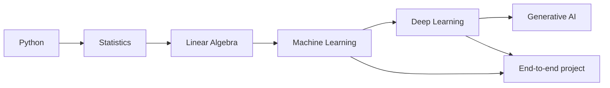
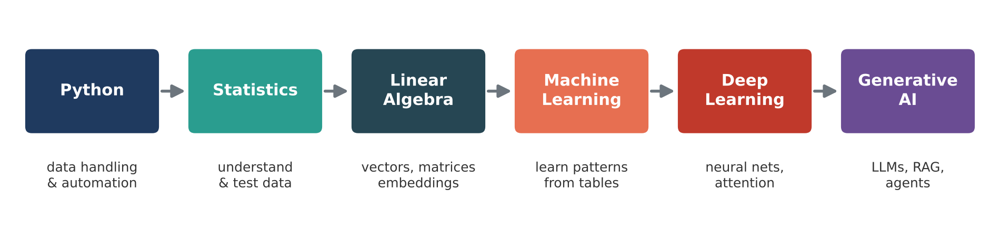
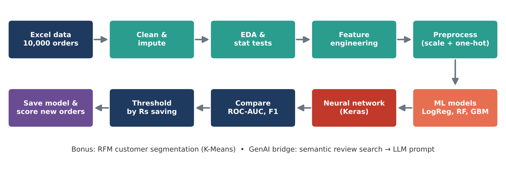

# Advanced Python for Generative AI – Prep Work Training

[](https://colab.research.google.com/github/anandjha90/Advanced-Python-for-GenAI-Prep-Training/blob/main/notebooks/00_Complete_Training_All_Modules.ipynb)


A 3-hour, hands-on module that takes learners from advanced Python to deep learning and Transformers. It covers the foundations needed before a Generative AI program: **Python → Statistics → Linear Algebra → Machine Learning → Deep Learning**. It ends with an **end-to-end e-commerce project** built on a 10,000-row dataset.

Every topic has theory, a real-world example and runnable code. Every notebook runs in **Google Colab with no installation**.





---

## Quick start (no installation)

1. Click an **Open in Colab** badge below.
2. In Colab, choose **Runtime > Run all**, or run each cell with **Shift + Enter**.
3. Optional: **Runtime > Change runtime type > T4 GPU** to speed up the deep learning cells.

The project notebook downloads `ecommerce_orders_10k.xlsx` from this repository by itself, so you don't need to upload anything.

| # | Module | Time | What you build | Notebook |
|---|---|---|---|---|
| 1 | Advanced Python for GenAI | 30 min | Prompt builder, retry decorator, text chunker for RAG, chat-history class, safe LLM-JSON parser, review pipeline | [](https://colab.research.google.com/github/anandjha90/Advanced-Python-for-GenAI-Prep-Training/blob/main/notebooks/01_Advanced_Python_for_GenAI.ipynb) |
| 2 | Statistics and Probability | 25 min | Outlier detection, Bayes fraud check, distributions, hypothesis tests, A/B test of a checkout page | [](https://colab.research.google.com/github/anandjha90/Advanced-Python-for-GenAI-Prep-Training/blob/main/notebooks/02_Statistics_and_Probability.ipynb) |
| 3 | Linear Algebra | 20 min | Cosine similarity, price solver (Ax = b), SVD recommender, PCA, mini semantic search | [](https://colab.research.google.com/github/anandjha90/Advanced-Python-for-GenAI-Prep-Training/blob/main/notebooks/03_Linear_Algebra.ipynb) |
| 4 | Machine Learning | 40 min | Preprocessing pipeline, house-price regression, cancer classification, tuning, RFM clustering, digit recognition | [](https://colab.research.google.com/github/anandjha90/Advanced-Python-for-GenAI-Prep-Training/blob/main/notebooks/04_Machine_Learning.ipynb) |
| 5 | Deep Learning | 35 min | Neuron and backprop from scratch, Keras MNIST, CNN, self-attention in NumPy, review sentiment model | [](https://colab.research.google.com/github/anandjha90/Advanced-Python-for-GenAI-Prep-Training/blob/main/notebooks/05_Deep_Learning.ipynb) |
| 6 | End-to-end project | 30 min | Order-return prediction: EDA, statistical tests, ML + DL models, business threshold, deployment, GenAI review search | [](https://colab.research.google.com/github/anandjha90/Advanced-Python-for-GenAI-Prep-Training/blob/main/notebooks/06_End_to_End_Project_Return_Prediction.ipynb) |
| – | All modules in one notebook | 3 hrs | Everything above | [](https://colab.research.google.com/github/anandjha90/Advanced-Python-for-GenAI-Prep-Training/blob/main/notebooks/00_Complete_Training_All_Modules.ipynb) |

> In Modules 1–5, each code cell is self-contained and can be run on its own. In Module 6, cells must run **in order**, because later steps use variables from earlier ones.

---

## Repository structure

```text
Advanced-Python-for-GenAI-Prep-Training/
├── README.md
├── requirements.txt                 # only needed for running locally
├── .gitignore
├── notebooks/                       # open these in Colab or Jupyter
│   ├── 00_Complete_Training_All_Modules.ipynb
│   ├── 01_Advanced_Python_for_GenAI.ipynb
│   ├── 02_Statistics_and_Probability.ipynb
│   ├── 03_Linear_Algebra.ipynb
│   ├── 04_Machine_Learning.ipynb
│   ├── 05_Deep_Learning.ipynb
│   └── 06_End_to_End_Project_Return_Prediction.ipynb
├── data/
│   └── ecommerce_orders_10k.xlsx    # 10,000 orders + data dictionary sheet
├── docs/
│   └── Advanced_Python_for_GenAI_Prep_Training.docx   # full training handbook
├── images/                          # diagrams used in the notebooks and handbook
└── src/                             # the same code as plain .py scripts
    ├── module1_python/
    ├── module2_statistics/
    ├── module3_linear_algebra/
    ├── module4_machine_learning/
    ├── module5_deep_learning/
    └── module6_project/             # p00 ... p14 + run_all.py
```

---

## Run locally (optional)

You need Python 3.10–3.12 and Git.

```bash
git clone https://github.com/anandjha90/Advanced-Python-for-GenAI-Prep-Training.git
cd Advanced-Python-for-GenAI-Prep-Training

python -m venv .venv
# Windows: .venv\Scripts\activate
# macOS / Linux:
source .venv/bin/activate

pip install -r requirements.txt
jupyter notebook notebooks/
```

To run the plain scripts instead of the notebooks, start from the repository root:

```bash
python src/module1_python/m1_03_decorators.py      # any single topic script
python src/module6_project/run_all.py              # the full project, steps p00 to p14 in order
```

---

## Datasets

| Used in | Dataset | Source | Download needed? |
|---|---|---|---|
| Module 3 | Wine (178 samples) | Bundled with scikit-learn | No |
| Module 4 | Breast Cancer Wisconsin (569 samples), Digits (1,797 images) | Bundled with scikit-learn | No |
| Module 4 | California Housing (20,640 districts) | `fetch_california_housing()` | Automatic, first run only |
| Module 5 | MNIST (70,000 images), IMDB reviews (50,000) | `keras.datasets` | Automatic, first run only |
| Module 6 | E-commerce orders (10,000 rows) | `data/ecommerce_orders_10k.xlsx` in this repo | Automatic, from this repo |

### E-commerce dataset (`data/ecommerce_orders_10k.xlsx`)

This dataset is realistic but **simulated**. It covers calendar year 2025: about 2,900 customers, 20 Indian cities, 7 categories and 41 products. Missing values are included on purpose so learners can practise cleaning. The `Data_Dictionary` sheet describes every column.

| Column group | Columns |
|---|---|
| Order | `Order_ID`, `Order_Date` |
| Customer | `Customer_ID`, `Customer_Age`*, `Gender`, `City`, `City_Tier`, `Is_Member`, `Previous_Orders` |
| Product and price | `Category`, `Product_Name`, `Unit_Price`, `Quantity`, `Discount_Pct`, `Order_Value` |
| Behaviour | `Payment_Method`, `Device_Type`*, `Session_Duration_Min` |
| After delivery | `Delivery_Days`, `Customer_Rating`*, `Review_Text`* |
| **Target** | `Returned` (Yes / No, about 18% Yes) |

\* contains missing values

---

## End-to-end project: e-commerce order return prediction



**Business goal:** score every order right after delivery with a return-risk probability. Support can then contact high-risk customers before they raise a return, for example with an exchange or size help.

| Step | What happens | Concepts used |
|---|---|---|
| 0–2 | Load, inspect and clean the data | Pandas, imputation |
| 3 | EDA charts: return rate by category, payment, delivery days and rating | Matplotlib, Seaborn |
| 4 | Chi-square tests, t-test, conditional probabilities, confidence interval | Statistics |
| 5–6 | Feature engineering, stratified split, `ColumnTransformer` | Preprocessing |
| 7 | Logistic Regression, Random Forest, Gradient Boosting | Machine learning |
| 8 | Pick the decision threshold that maximises rupee savings | Business metrics |
| 9 | Keras neural network with dropout, batch normalisation and class weights | Deep learning |
| 10–11 | ROC curves, confusion matrix, feature importance, business insights | Evaluation |
| 12 | Save the pipeline with `joblib` and score new orders | Deployment |
| 13 | RFM customer segmentation with K-Means | Unsupervised learning |
| 14 | Semantic search over reviews and an LLM-ready prompt | GenAI / RAG retrieval |

**Results from our test run:** ROC-AUC ranges from about 0.72 to 0.77. Logistic regression comes out best and catches about 70% of returns. The main drivers are Fashion category, low rating, COD payment and slow delivery. Neural network results can vary slightly from run to run.

---

## Troubleshooting

| Problem | Fix |
|---|---|
| `ModuleNotFoundError: No module named 'google.colab'` in project Step 0 | This happens only outside Colab when the data file can't be found or downloaded. Run the notebook from the `notebooks/` folder, or run the scripts from the repository root, so `data/ecommerce_orders_10k.xlsx` is found. |
| Dataset download fails on an office network | Download `data/ecommerce_orders_10k.xlsx` from GitHub and upload it in the Colab **Files** panel (left sidebar), then rerun Step 0. |
| Deep learning cells are slow | In Colab: **Runtime > Change runtime type > T4 GPU**. |
| `NameError` in Module 6 | A previous step was skipped. Run the cells from Step 0 onwards, in order. |
| TensorFlow fails to install locally | Use Python 3.10–3.12, or simply use Colab, where TensorFlow is already installed. |
| Results differ slightly from the handbook | Random seeds are fixed, but neural network training can still vary a little between library versions and hardware. |

---

## Training handbook

[`docs/Advanced_Python_for_GenAI_Prep_Training.docx`](docs/Advanced_Python_for_GenAI_Prep_Training.docx) is the 55-page trainer and learner handbook. It has the theory, 13 diagrams, real-world examples and every code block from the notebooks. GitHub can't preview `.docx` files, so click **Download raw file** to open it.

In the handbook, project Step 0 asks learners to upload the dataset. In the notebooks in this repository, Step 0 downloads it automatically instead. All other code is identical.

---

## Author

**Anand Kumar Jha** – [ANALYTICSWITHANAND](https://github.com/anandjha90/ANALYTICSWITHANAND)
